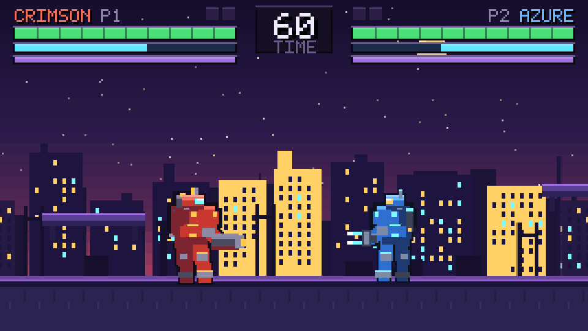
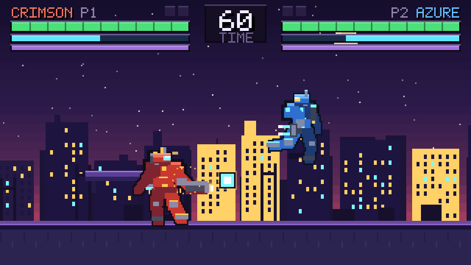
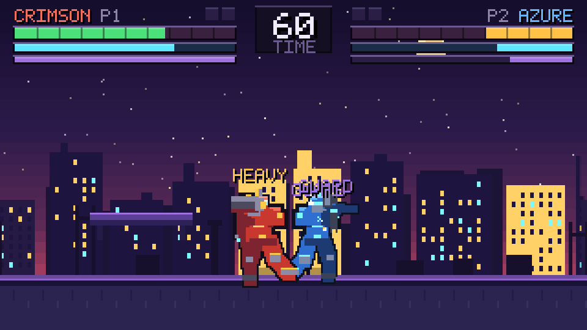

# 像素机甲对决 · PIXEL MECH ARENA

复古像素风格的 1v1 街机格斗 Demo。零依赖、零二进制素材，纯原生 ES Modules + Canvas 2D。



---

## 一、运行方式

```bash
cd pixel-mech-arena
npm start          # 启动静态服务器，访问 http://localhost:5173
```

无需 `npm install`——本项目没有任何运行时依赖，Node ≥ 18 即可。

| 脚本 | 作用 |
| --- | --- |
| `npm start` | 启动零依赖静态服务器（`server.mjs`） |
| `npm run check` | 静态检查：语法校验 + 模块导入解析 + HTML 资源引用 |
| `node scripts/render.mjs` | 无头渲染自测：在 Node 中跑真实游戏代码，导出 PNG 帧并断言战斗逻辑 |
| `node scripts/zoom.mjs` | 把导出的帧放大 3 倍，便于肉眼审查像素细节 |

> `scripts/render.mjs` 依赖 `skia-canvas`，仅用于开发期自测；游戏本身完全不需要它。

---

## 二、玩法设计

### 2.1 角色

| | 赤焰 CRIMSON (P1) | 苍岚 AZURE (P2) |
| --- | --- | --- |
| 定位 | 重型 | 轻型 |
| 体型 | 肩宽臂粗、宽胸窄腰，装甲厚实 | 身形瘦长，护甲轻量 |
| 专属部件 | 背包推进器 + 后肩肩炮 | 背部推进翼 |
| 主武器 | 融合炮（15×9 像素炮身，可蓄能发光） | 等离子爪刃（双层能量刃） |
| 能量核心 | 暖黄色 | 冷白色 |

两台机甲共用一套骨骼系统，体型差异通过参数（肩宽、四肢长度、护甲厚度）驱动，而非两套独立美术资源。

### 2.2 操作

| 动作 | P1 | P2 |
| --- | --- | --- |
| 左 / 右移动 | `A` / `D` | `←` / `→` |
| 跳跃 | `W` | `↑` |
| 防御 | `S` | `↓` |
| 轻击 | `J` | `,` |
| 重击 | `K` | `.` |
| 必杀 | `L` | `/` |

全局：`Enter` 开始 / 重开，`P` 或 `Esc` 暂停。标题界面可直接选择「单人挑战 CPU」「双人对战」「困难模式」。

### 2.3 招式表

数值集中在 [`src/data/config.js`](src/data/config.js) 的 `ATTACKS`，单位为帧（60FPS）。

| 招式 | 起手 | 判定 | 收招 | 伤害 | 击退 | 硬直 | 顿帧 | 消耗 | 说明 |
| --- | --- | --- | --- | --- | --- | --- | --- | --- | --- |
| 轻击 | 5 | 4 | 10 | 6 | 1.7 | 12 | 5 | 0 | 快、伤害低，命中回 8 能量 |
| 重击 | 13 | 6 | 22 | 15 | 4.4 | 22 | 9 | 0 | 慢、伤害高、有挑飞，命中回 14 能量 |
| 必杀 | 26 | 6 | 26 | 22 | 4.0 | 26 | 8 | 50 | 蓄力后发射能量弹（独立弹幕实体） |

三段帧结构（`startup` / `active` / `recovery`）意味着每个招式都有明确的**起手预告**与**收招破绽**，这是格斗手感的基础。

### 2.4 资源条

- **血量 HP**：上限 100，归零即 KO。
- **能量 Energy**：上限 100，开局 60，每秒回复 1.6（使用必杀时停止回复）。必杀消耗 50，轻击/重击命中回能。
- **护盾 Guard**：上限 100，每秒回复 9。防御成功时按招式扣减（轻击 12 / 重击 34 / 必杀 46）；护盾归零则破防，进入 30 帧硬直。护盾破防后有 0.9 秒回盾延迟。

### 2.5 防御机制

只有当**机甲处于防御姿态**且**面朝攻击来源**时才算防御成功（`Fighter.applyHit`）。此时：

- 承受伤害大幅削减：轻击 ×0.12，重击 ×0.30，必杀 ×0.45；
- 消耗护盾值并施加小幅击退；
- 触发防御火花特效与音效，不进入受击硬直。

这意味着「背对对手按防御」无效，玩家必须转身格挡。

### 2.6 胜负机制

三局两胜制（`RULES.roundsToWin = 2`），每回合 60 秒。

1. 血量归零 → 立即 KO，画面进入慢动作（0.28 倍速）+ 屏幕震动 + 碎片粒子，结算该回合。
2. 计时结束 → 比较双方剩余血量，高者胜；血量相同判平局。
3. 任一方累计 2 回合胜利 → 比赛结束，展示结算面板。

回合间自动重置双方位置、血量、能量、护盾与弹幕，保留已胜回合数。

### 2.7 场景与地形

- 地面位于 `y = 150`，世界宽 640，摄像机跟随双方中点。
- 四块可站立平台（`ARENA_PLATFORMS`），提供高低差与跳跃空间。
- 双方间距被约束在 26 ~ 210 像素之间：过近互相推开，过远则拉回，保证两台机甲始终同框。
- 判定为 AABB 重叠：攻击盒（`attackbox`）vs 受击盒（`hurtbox`）。必杀为弹幕类招式，不产生近身判定盒，避免双重判定。

### 2.8 CPU 对手

[`src/systems/ai.js`](src/systems/ai.js) 实现了带反应延迟的简单行为树，输出与玩家完全相同的虚拟输入，因此 AI 和玩家走的是同一套代码路径。

行为：`approach`（逼近）/ `retreat`（拉开）/ `attack`（出招）/ `guard`（格挡）。

| 难度 | 反应帧 | 进攻倾向 | 格挡率 | 跳跃率 | 必杀率 |
| --- | --- | --- | --- | --- | --- |
| EASY | 16 | 0.45 | 0.18 | 0.03 | 0.15 |
| NORMAL | 10 | 0.65 | 0.40 | 0.06 | 0.30 |
| HARD | 5 | 0.85 | 0.68 | 0.10 | 0.50 |

AI 还有「血量低于 25 且对手靠近时后撤」的自保逻辑。

### 2.9 手感细节

- **命中定格（hitstop）**：命中瞬间冻结逻辑帧 5~9 帧，强化打击感。
- **屏幕震动**：轻击 2px、重击 4px、必杀命中 5px，指数衰减。
- **KO 慢动作**：0.28 倍速持续 70 帧。
- **受击闪白**：6 帧内用纯白剪影覆盖角色。
- **连击计数**：连续命中累计并显示 `N HIT`。
- **伤害飘字**：命中数值向上飘出并渐隐。

---

## 三、核心代码结构

```
pixel-mech-arena/
├── index.html              入口页面（DOM 覆盖层：标题 / 结算 / 暂停）
├── styles.css              CRT 扫描线、像素风 UI
├── server.mjs              零依赖静态服务器
├── scripts/
│   ├── check.mjs           静态检查（语法 / 导入 / 资源引用）
│   ├── render.mjs          无头渲染自测（跑真实代码导出 PNG + 逻辑断言）
│   ├── zoom.mjs            帧放大 3×，用于像素级审查
│   └── debug.mjs           摄像机取景诊断
└── src/
    ├── main.js             入口：画布初始化、场景调度、UI 绑定、主循环
    ├── core/
    │   ├── engine.js       固定步长循环（逻辑 60FPS，渲染跟 rAF）
    │   ├── input.js        键盘状态 + 边沿事件（justPressed）+ 键位表
    │   ├── audio.js        WebAudio 芯片音效（全部实时合成）
    │   └── rng.js          mulberry32 确定性随机
    ├── data/
    │   ├── config.js       视口/物理/规则/招式/平台/出生点 全局数值
    │   ├── palette.js      角色调色板 + 场景配色
    │   └── font.js         5×7 点阵字体（ASCII）
    ├── entities/
    │   ├── fighter.js      机甲：状态机 + 物理 + 判定盒 + 受击/防御
    │   └── projectile.js   弹幕：独立飞行实体，带拖尾
    ├── systems/
    │   ├── combat.js       战斗结算：攻击盒碰撞、命中、防御、弹幕命中
    │   └── ai.js           CPU 行为树
    ├── render/
    │   ├── pixel.js        像素绘制工具（整数对齐 rect / 阶梯线段）
    │   ├── mech.js         机甲渲染：骨骼驱动 + 两遍法描边
    │   ├── stage.js        视差背景（远/中/近三层 + 星空 + 地面）
    │   ├── hud.js          血条/能量/护盾/计时器/横幅/连击/飘字
    │   └── particles.js    粒子系统（火花/碎片/烟雾/冲击波）
    └── scenes/
        └── battle.js       对战场景：回合流程、相机、输入分发、结算
```

### 3.1 分层原则

```
main.js  ──▶  scenes/battle.js  ──▶  entities/fighter.js
                    │                   entities/projectile.js
                    ├──▶  systems/combat.js   （纯判定，无渲染）
                    ├──▶  systems/ai.js        （只产出虚拟输入）
                    └──▶  render/*            （只读状态，不改状态）
```

关键约束：**`systems/` 与 `render/` 都不直接改写实体状态**。战斗结果通过 `applyHit()` 写回实体，特效通过一个 `fx` 桥接对象回传给场景（粒子、音频、顿帧、震动）。这样保证了：

- AI 与玩家共用完全相同的输入/状态机路径，不存在「AI 特权」；
- 渲染层可以在无头环境（Node）中独立运行并被测试；
- `scripts/render.mjs` 能直接 import 真实游戏代码做逻辑断言。

### 3.2 状态机

`Fighter.state` 共 11 态：

```
idle ⇄ walk ⇄ jump → fall → idle
  ↓     ↓
block  light / heavy / special → idle
  ↓
hurt → idle
  ↓
ko
```

- 移动：`handleGroundInput()` 处理地面输入，`handleAirInput()` 处理空中输入（空中不可出招，但下落时可放必杀）。
- 招式：`handleAttack()` 只负责推进 `attackT` 帧计数与释放弹幕标记，判定由 `combat.js` 独立完成。
- 物理：`applyPhysics()` 统一处理重力、边界、地面/平台碰撞。

### 3.3 骨骼驱动的角色动画

这是本 Demo 在美术上的核心取舍：**不逐帧手绘精灵图，而是用一套骨架 + 姿态参数实时生成角色**。

```
computePose(f)  →  姿态参数（手臂角度、膝盖角度、前倾、下蹲量、蓄力光）
        ↓
skeleton(f, p)  →  关节坐标（骨盆/胸/头/肩/肘/手/髋/膝/脚）
        ↓
drawBody()      →  像素绘制（两遍：先描边层，再填充层）
```

好处：

1. 招式动画只需描述「关键姿态」并做插值，新增招式成本极低；
2. 重型/轻型共用一套骨架，差异仅在参数；
3. 面向翻转只需 `ctx.scale(facing, 1)`，不需要准备左右两套素材；
4. 姿态可被物理状态连续驱动（走路循环、重击蓄力后仰等）。

像素硬边的保证：所有斜向肢体用 `limb()` 沿路径画阶梯方块，不使用 `lineTo` 抗锯齿；所有 `fillRect` 坐标先 `Math.round()`。

描边采用**两遍法**：第一遍把整台机甲放大 2px 用统一描边色画一遍，第二遍正常画本体，天然得到干净的 1px 外轮廓。

### 3.4 渲染管线

- 逻辑分辨率固定 320×180，Canvas 按 `image-rendering: pixelated` 放大到窗口；关闭 `imageSmoothingEnabled`。
- 固定步长累加器循环（`Engine`），逻辑恒定 60FPS，渲染跟随 `requestAnimationFrame`，单帧最多补 5 步防止卡顿雪崩。
- 场景绘制顺序：视差背景 → 平台 → 角色（按 z 排序）→ 弹幕 → 粒子 → 飘字 → HUD → 横幅。

---

## 四、基础素材方案

**全部素材程序化生成，工程内不含任何 `.png` / `.wav` 文件。** 这让 Demo 免去资源下载与版权问题，同时保证任意分辨率下的像素对齐。

### 4.1 调色板

角色各 13 色（`src/data/palette.js`），遵循复古街机「暗部 / 中间调 / 高光 + 描边 + 金属 + 强调色」结构：

```
outline      描边（近黑，用于把机体从背景里剥出来）
armorDark    装甲暗部
armorMid     装甲中间调（主体色）
armorLight   装甲高光
accent       强调色（红机金 / 蓝机青）
glow         能量辉光
visor        光学面罩
beam         能量弹 / 蓄力光
metal / metalLight   机械结构（枪管、关节、脚掌）
core         胸口能源核心
```

场景配色另 12 色（`SCENE_COLORS`）：黄昏紫蓝渐变天空、暖黄与冷青交替的窗光、地平线辉光。

### 4.2 角色像素图

机甲高约 50px（占 180px 视口高度约 1/3.6），接近街机格斗角色的视觉体量。构成部件：

- 头部：额甲 + 光学面罩（带 1px 高光）+ 下颚装甲 + 顶部散热鳍/天线
- 躯干：上胸装甲板 + 胸口能源核心 + 两侧散热格栅
- 肩部：阶梯形肩甲（上窄下宽）+ 重型专属肩炮
- 背部：重型背包推进器 / 轻型推进翼
- 手臂：上臂 → 前臂护板 → 手部机械关节
- 腰部：腰甲板 + 强调色扣件
- 腿部：大腿 → 膝甲 → 小腿 → 脚掌
- 武器：融合炮 / 等离子爪刃

### 4.3 场景

程序化生成三层可横向平铺的离屏画布，绘制时按视差系数偏移：

| 层 | 视差系数 | 内容 |
| --- | --- | --- |
| 星空 | 0.04 | 90 颗 1px 星点，随机亮度 |
| 远景 | 0.18 | 剪影楼群 + 屋顶天线 |
| 中景 | 0.42 | 建筑 + 屋顶结构 + 窗格（暖黄/冷青/熄灭随机） |
| 前景 | 1.10 | 管道、支架、箱体剪影 |

天空用 26 条水平色带做四段渐变（顶 → 中 → 低 → 辉光），叠加一轮像素月亮。
地面为 4px 厚的分层结构（地表高光 + 唇线 + 暗部 + 地砖竖缝纹理），纹理随相机滚动。

随机性使用 mulberry32 固定种子，**每次运行场景完全一致**，便于回归比对。

### 4.4 字体

`src/data/font.js` 手写 5×7 点阵字形，每个字形 7 行、每行 5 bit（十进制表示），覆盖 A-Z、0-9 与常用标点。

因点阵字体只含 ASCII 画布内 UI 一律使用英文（`CRIMSON` / `AZURE` / `FIGHT!` / `K.O.` / `TIME UP`），中文（赤焰 / 苍岚 / 结算文案）由 DOM 覆盖层用系统字体渲染——两者各取所长。

### 4.5 音效

`src/core/audio.js` 用 WebAudio 的振荡器与噪声实时合成，无音频文件：

| 音效 | 合成方式 |
| --- | --- |
| 命中（轻） | 高通噪声 + 220Hz 方波下滑 |
| 命中（重） | 380Hz 高通噪声 + 130Hz 锯齿波下滑 |
| 防御 | 900Hz 方波上滑 + 3kHz 高通噪声 |
| 必杀 | 锯齿波 + 方波上滑 + 噪声叠层 |
| KO | 低频噪声 + 两段方波下滑 |
| 回合开始 | 523/659/784/1046 琶音 |

---

## 五、截图

| 待机演出 | 必杀弹幕（苍岚起跳闪避） | 格挡对抗 |
| --- | --- | --- |
|  |  |  |

---

## 六、已知边界

- 无网络对战与手柄支持（键盘双人是当前上限）。
- 场景只有一张（黄昏城市），没有多关卡与角色选择。
- 音效为 WebAudio 合成，音色偏「芯片风」，与 90 年代街机音轨风格接近但非复刻。
- 逻辑帧固定 60FPS，极端卡顿时会丢帧（引擎限制单帧最多补 5 步）。
